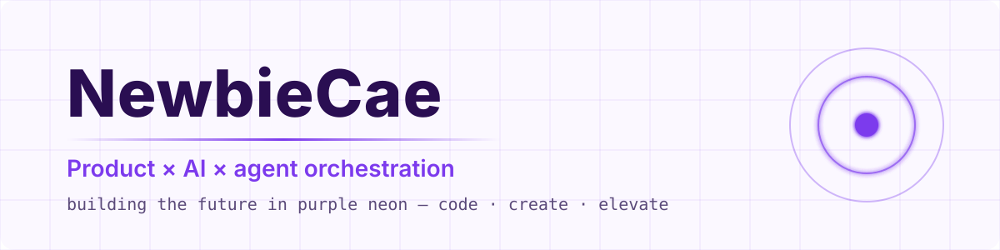
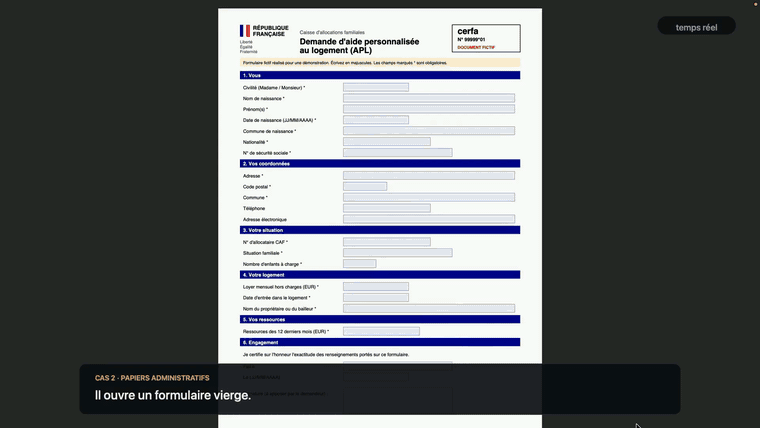
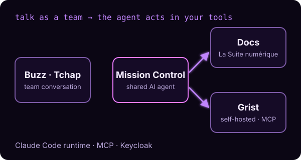
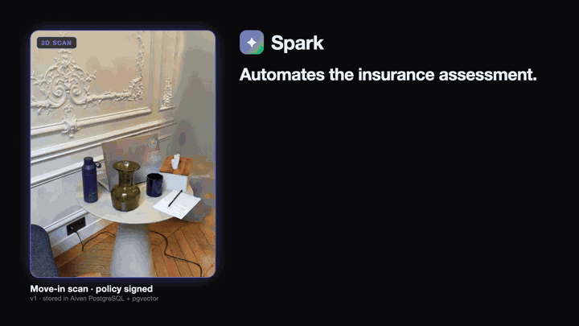
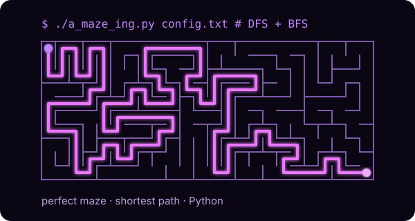

<picture>
  <source media="(prefers-color-scheme: dark)" srcset="assets/banner-dark.svg">
  
</picture>

 

I'm Céline, a 42 student building products where **AI acts at the right moment**. I lead their build with AI agents: I start from the user need, shape the product, then steer, test and validate. My projects end with a demo and measured results.

 

### I lead AI agents

<table>
  <tr>
    <td width="50%" valign="top">
      
      <h4 align="center"><a href="https://github.com/Bielorretto/bayscreen">Dès que</a></h4>
      
Write "as soon as X, do Y" in screenpipe, and an agent with screen memory acts at the right moment.

      

Read more
An "as soon as X, do Y" sentence written in screenpipe becomes a reflex: check an article's sources as soon as you leave Pages, fill in a form as soon as you open it, recall during a video call a price you saw on screen, cited with the time and the app. <b>My role:</b> coordinating the team and its AI agents, memory features built with Claude Code, real end-to-end testing, and the product through to the demo (use cases, pitch, video).

      
TypeScript · Bun · Claude

    </td>
    <td width="50%" valign="top">
      
      <h4 align="center"><a href="https://github.com/NewbieCae/FIREBREAK">FIREBREAK</a></h4>
      
A supply-chain firewall: quarantine only what depends on a compromised partner, not everything.

      

Read more
A firewall for supply chains: when a partner is compromised, only the operations that depend on it are quarantined, instead of freezing everything. In simulation (500 worlds): 9.6 healthy operations wrongly blocked, versus 43.2 with the standard approach. <b>My role:</b> product strategy and solution design: challenging the initial assumptions, finding the weak spots, strengthening the value proposition and the functional architecture.

      
<b><a href="https://firebreak-zeta.vercel.app/app/">live demo</a></b> · Python · Ed25519 · Solidity

    </td>
  </tr>
  <tr>
    <td width="50%" valign="top">
      
      <h4 align="center"><a href="https://github.com/NewbieCae/mission-controle">Mission Control</a></h4>
      
A shared AI agent that turns team conversations into actions in Docs and Grist.

      

Read more
An AI agent shared by a team: it understands conversations in Buzz (Tchap) and acts in Docs and Grist from La Suite numérique. <b>My role:</b> product lead, functional design, demo scenarios and testing, and steering part of the implementation with AI agents.

      
Claude Code · MCP · Grist · Keycloak

    </td>
    <td width="50%" valign="top">
      
      <h4 align="center"><a href="https://github.com/paragsarvoday/Spark">Spark · Lumen Claims</a></h4>
      
Film a room; after a loss, a Claude agent finds what's missing, prices it and drafts the settlement.

      

Read more
Film a room in 30 seconds. After a theft or a loss, a Claude agent works like a loss adjuster: it compares the two scans, finds what's missing, prices it with sources, reads the policy and drafts the settlement. Against a single LLM call: 0 false alarms versus 6. <b>My role:</b> the demo video, built in code with Remotion and a synced ElevenLabs voice-over.

      
<b><a href="https://github.com/paragsarvoday/Spark/blob/main/demo-video/Spark_Demo_Final.mp4">demo video</a></b> · Python · Claude · pgvector · Modal · Remotion

    </td>
  </tr>
</table>

 

### I also code without them

42 school projects: no AI assistant, peer evaluation.

<table>
  <tr>
    <td width="50%" valign="top">
      
      <h4 align="center"><a href="https://github.com/NewbieCae/Amazing">A-Maze-ing</a></h4>
      
Maze generator (DFS) with shortest path (BFS), terminal and Pygame display.

      

Read more
Perfect or imperfect maze generator (DFS) with a hidden "42", shortest path (BFS), terminal and Pygame display, and a reusable Python package.

      
<b>42 project · no AI</b> Python · Pygame

    </td>
  </tr>
</table>

 

### Stack

  

---

building the future in purple neon · code · create · elevate

